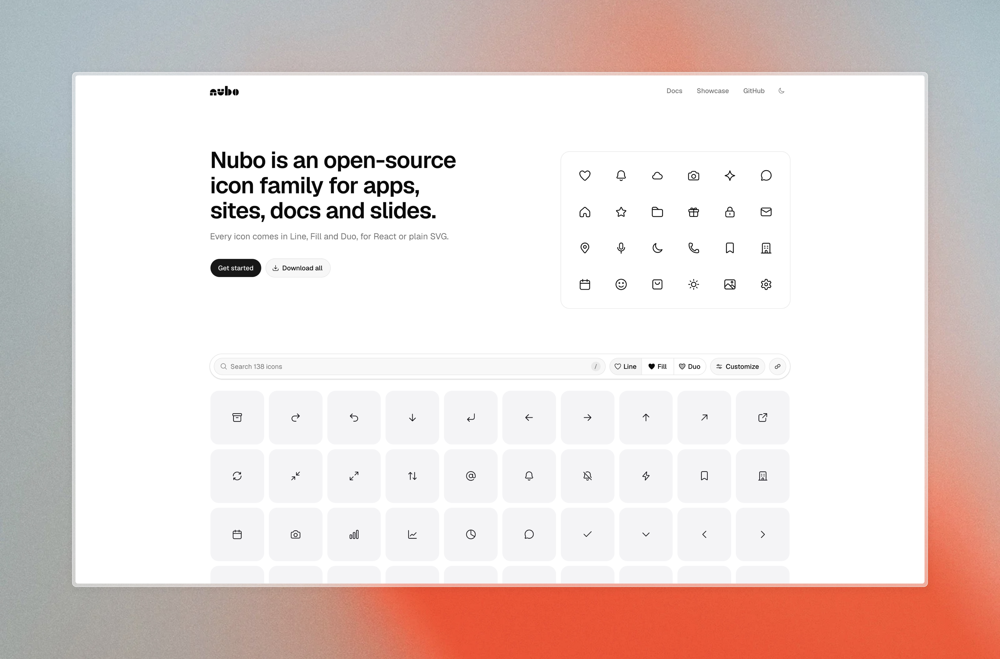

[](https://nubo.davidumoru.me)

# Nubo

Soft, open-source icons for React and plain SVG. Every icon comes in Line, Fill and Duo, drawn on the same 24px grid, so switching style never moves your layout.

**[Browse the icons](https://nubo.davidumoru.me)** · [Docs](https://nubo.davidumoru.me/docs) · [npm](https://www.npmjs.com/package/@nubo-icons/react) · [Roadmap](https://nubo.davidumoru.me/docs/roadmap)

## Use it

```sh
pnpm add @nubo-icons/react
```

```tsx
import { HeartIcon } from "@nubo-icons/react";
import { BellIcon } from "@nubo-icons/react/fill";
import { CloudIcon } from "@nubo-icons/react/duo";

<HeartIcon size={20} />;
```

Not using React? Every icon can be copied or downloaded as SVG or PNG from [the site](https://nubo.davidumoru.me), or grab [the whole set as a zip](https://nubo.davidumoru.me/nubo-icons.zip).

| Package                               | What it is                                     |
| ------------------------------------- | ---------------------------------------------- |
| [`@nubo-icons/react`](packages/react) | React components, with ESM, CommonJS and types |

## Request an icon

Missing something? [Open an issue](https://github.com/davidumoru/nubo-icons/issues/new) with the icon you need and what it's for. Icons are added in reviewed batches, every icon in all three styles.

## Contributing

The design rules every icon follows are in [DESIGN.md](DESIGN.md). Please read them before drawing or changing an icon, and don't copy paths from other icon sets.

| Path                         | What lives there                                                                |
| ---------------------------- | ------------------------------------------------------------------------------- |
| [`icons/`](icons)            | The source of truth: `line.svg`, `fill.svg`, `duo.svg` and `meta.json` per icon |
| [`packages/`](packages)      | Published packages, generated from `icons/`                                     |
| [`tools/icons`](tools/icons) | Icon lint and review-sheet scripts                                              |
| [`apps/web`](apps/web)       | The website and docs                                                            |
| [`docs/`](docs)              | The research and roadmap behind the project                                     |

You need Node 24 and pnpm.

```sh
pnpm install
pnpm icons:lint            # check every icon against the design rules
pnpm build && pnpm test    # build the packages and test them against the SVG sources
pnpm --filter web dev      # run the site locally
```

Changes to a package need a changeset: run `pnpm changeset` and commit the file it creates. Releases are versioned from those.

## License

[MIT](LICENSE)
